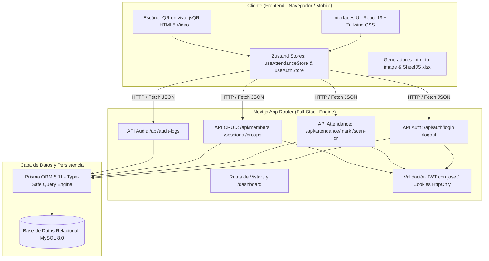

# 📋 MJVC Attendance — Sistema Integral de Control de Asistencias

Sistema web full-stack diseñado para la gestión, registro ágil mediante códigos QR, control de asistencias interactivo, auditoría y emisión de reportes analíticos para el **Movimiento de Jornadas de Vida Cristiana (MJVC — EAs Jesús)**.

---

## 🏛️ 1. Arquitectura del Sistema

El proyecto está diseñado bajo el patrón **Full-Stack Modular Monolith (Monolito Modular)** utilizando **Next.js (App Router)** con TypeScript, desacoplado en capas lógicas bien definidas:



### Capas de la Arquitectura

1. **Capa de Presentación (Frontend / UI)**
   - **React 19 & Next.js App Router**: Componentes divididos entre Server Components (para layouts y estructuras base) y Client Components reactivos (para módulos interactivos como la matriz de asistencias, cámara QR y modales).
   - **Tailwind CSS v4 & Lucide Icons**: Sistema de diseño responsivo *Mobile-First*, optimizado para pantallas táctiles y escritorios con tema institucional azul marino (`#0D356A`), contrastes accesibles y microinteracciones fluidas.
   - **Zustand**: Gestión del estado global del cliente con *optimistic updates* (actualizaciones optimistas en la interfaz antes de esperar la respuesta del servidor para una experiencia sin latencia perceptible).

2. **Capa de Aplicación y APIs (Backend / Route Handlers)**
   - **Next.js Route Handlers (`src/app/api/...`)**: Endpoints RESTful tipados que procesan transacciones de marcado, validación de credenciales, ingesta de escaneos QR y generación de registros de auditoría.
   - **Control de Acceso Basado en Roles (RBAC)**: Segregación lógica de datos entre coordinaciones (`PREESCUELA`, `ESCUELA`, `SUPERADMIN`).

3. **Capa de Seguridad y Sesión**
   - **Tokens Criptográficos JWT (`jose`)**: Autenticación sin estado (*stateless*). Los tokens viajan en cookies seguras `HttpOnly` y `SameSite=Lax`, blindando la aplicación contra vulnerabilidades XSS y CSRF.

4. **Capa de Persistencia y Datos**
   - **Prisma ORM 5**: Capa de abstracción relacional *type-safe* que garantiza la coherencia de esquemas, migraciones reproducibles y prevención automática de inyecciones SQL.
   - **MySQL 8.0**: Motor de base de datos relacional transaccional (ACID), con relaciones foráneas en cascada, índices optimizados y compatibilidad para migración directa a PostgreSQL / Supabase en producción.

5. **Capa de Infraestructura y Contenedores**
   - **Docker & Docker Compose**: Configuración multi-etapa (*multi-stage build*) con aislamiento de servicios para base de datos persistida, ejecución de migraciones automáticas y la aplicación empaquetada.

---

## 🎯 2. ¿Por qué esta Arquitectura? (Justificación y Decisiones de Diseño)

La selección de esta arquitectura responde directamente a los retos del entorno operativo de jornadas y retiros juveniles:

### 1. Monolito Full-Stack vs. Arquitectura Separada (Frontend + Backend independiente)
* **¿Por qué?** Dividir el sistema en dos repositorios o dos servidores independientes (por ejemplo, React en Vite + Express en otro servidor) añade sobrecarga de configuración de CORS, doble despliegue, duplicación de interfaces TypeScript y mayor costo de mantenimiento.
* **Beneficio:** Al usar Next.js, frontend y backend comparten modelos de datos, validaciones y utilidades en un único repositorio con **End-to-End Type Safety**, simplificando drásticamente el despliegue y la continuidad del proyecto por nuevos desarrolladores de la comunidad.

### 2. Estado Global Reactivo con Zustand (en lugar de React Context o Redux)
* **¿Por qué?** La tabla de asistencias contiene decenas de integrantes cruzados con múltiples sesiones, donde cada celda es un sello interactivo. Con React Context nativo, la actualización de una sola celda provoca el re-renderizado de toda la tabla, generando tirones visuales en dispositivos móviles. Redux, por su parte, añadía demasiada complejidad y código repetitivo (*boilerplate*).
* **Beneficio:** Zustand permite suscripciones atómicas por selector. Solo la fila o celda modificada se re-renderiza. Además, facilita implementar el patrón de **actualización optimista**: cuando el coordinador toca un sello, la interfaz cambia al instante (0 ms) y sincroniza en segundo plano.

### 3. Base de Datos Relacional (MySQL / PostgreSQL) vs. NoSQL (MongoDB)
* **¿Por qué?** El dominio del problema es estrictamente relacional: un Grupo tiene Integrantes y Sesiones; la intersección entre un Integrante y una Sesión genera una Asistencia única (`@@unique([memberId, sessionId])`); y cada acción genera un Log de Auditoría inmutable.
* **Beneficio:** La base de datos relacional impone integridad referencial estricta a nivel motor. Si se elimina un miembro o una sesión, las asistencias asociadas se limpian limpiamente mediante cascada (`onDelete: Cascade`), garantizando que jamás existan registros huérfanos o métricas inconsistentes.

### 4. Autenticación con Teclado Numérico PIN + JWT en Cookies HttpOnly
* **¿Por qué?** En la dinámica de una reunión presencial, los coordinadores necesitan acceder rápidamente desde sus celulares sin escribir correos electrónicos ni contraseñas alfanuméricas complejas.
* **Beneficio:** Un teclado numérico táctil en pantalla de 4 dígitos tipo cajero (POS) permite iniciar sesión en menos de 3 segundos. Tras bambalinas, el backend valida el PIN y emite una cookie cifrada con JWT válida por 30 días, combinando máxima usabilidad con seguridad sólida.

### 5. Escáner QR Nativo en el Navegador (`jsQR`) sin App Nativa
* **¿Por qué?** Exigir a los coordinadores instalar una aplicación móvil de la Play Store o App Store representaba una barrera de adopción y costos de mantenimiento para Android e iOS.
* **Beneficio:** La Web API de `getUserMedia` combinada con `jsQR` procesa los fotogramas de la cámara directamente en el navegador del teléfono a 60 FPS, permitiendo escanear gafetes o tarjetas a la entrada con feedback sonoro y háptico al instante.

### 6. Exportación de Tarjetas de Lealtad en el Cliente (`html-to-image` + Web Share API)
* **¿Por qué?** Renderizar imágenes en un servidor backend con librerías como Puppeteer consume altos recursos de CPU y memoria.
* **Beneficio:** La tarjeta física/digital de sellos de asistencia se dibuja como un nodo DOM de alta fidelidad y el navegador del cliente la rasteriza a PNG a resolución 3x. Mediante la **Web Share API**, el coordinador puede compartirla directamente a WhatsApp con el participante o sus padres con un solo toque.

---

## 🛠️ 3. Detalles de Tecnologías Utilizadas

| Categoría | Tecnología / Librería | Versión | Propósito en el Sistema |
| :--- | :--- | :--- | :--- |
| **Framework Base** | [Next.js](https://nextjs.org/) | `15.x / Latest` | Framework Full-Stack con App Router, Server Components y Route Handlers. |
| **Librería UI** | [React](https://react.dev/) | `19.x / Latest` | Renderizado declarativo de componentes e interfaces de usuario. |
| **Lenguaje** | [TypeScript](https://www.typescriptlang.org/) | `^5.x` | Tipado estricto estático de extremo a extremo (modelos, props, APIs). |
| **Estilos & Diseño** | [Tailwind CSS](https://tailwindcss.com/) | `v4.x` | Motor de estilos utilitarios modernos con tokens de diseño CSS nativos. |
| **Animaciones** | `tailwindcss-animate` | `^1.0.7` | Transiciones fluidas, modales emergentes y animaciones de entrada/salida. |
| **Iconografía** | [Lucide React](https://lucide.dev/) | `^0.368.0` | Set de íconos vectoriales consistentes y ligeros. |
| **Gestor de Estado** | [Zustand](https://zustand-demo.pmnd.rs/) | `^4.5.2` | Almacén de estado global desacoplado para miembros, sesiones, bitácora y sesión activa. |
| **ORM & Modelado** | [Prisma](https://www.prisma.io/) | `5.11.0` | ORM con cliente autogenerado, migraciones automáticas y tipado fuerte. |
| **Base de Datos** | [MySQL](https://www.mysql.com/) | `8.0` | Motor relacional de base de datos transaccional (preparado también para PostgreSQL). |
| **Criptografía & Auth** | [jose](https://github.com/panva/jose) | `^6.2.12` | Generación y verificación de JSON Web Tokens (JWT) con estándar Edge-compatible. |
| **Lector QR** | [jsQR](https://github.com/cozmo/jsQR) | `^1.4.0` | Algoritmo de visión por computadora para decodificación de códigos QR desde canvas de video. |
| **Generador QR** | [qrcode.react](https://github.com/zpao/qrcode.react) | `^4.2.0` | Renderizado de credenciales QR individuales para los integrantes. |
| **Exportación Gráfica** | [html-to-image](https://github.com/bubkoo/html-to-image) | `^1.11.13` | Conversión del DOM de la tarjeta de asistencia a imágenes PNG de alta resolución (3x DPI). |
| **Exportación Datos** | [xlsx (SheetJS)](https://sheetjs.com/) | `0.18.5` | Generación de hojas de cálculo Excel (`.xlsx`) con métricas y porcentajes de asistencia. |
| **Efectos Visuales** | `canvas-confetti` | `^1.9.4` | Animación de confeti celebratorio al registrar asistencias perfectas o escanear con éxito. |
| **Testing** | [Vitest](https://vitest.dev/) | `^5.0.1` | Suite de pruebas unitarias y de integración de alto rendimiento. |
| **Contenedores** | [Docker & Compose](https://www.docker.com/) | N/A | Entorno de base de datos aislada y empaquetado multi-etapa listo para producción. |

---

## 🗄️ 4. Modelo de Datos (Schema de Prisma)

El esquema relacional en `prisma/schema.prisma` modela fielmente las operaciones del movimiento:

```
┌──────────────────┐       ┌──────────────────┐
│      Group       │◄──────┤      Member      │
│  - id            │ 1   * │  - id            │
│  - slug          │       │  - name          │
│  - name          │       │  - isAuxiliar    │
│  - pin           │       │  - qrToken (UQ)  │
│  - customTitle   │       └────────┬─────────┘
└────────┬─────────┘                │ 1
         │ 1                        │
         │                          │ *
         │ *                        ▼
┌────────┴─────────┐       ┌──────────────────┐
│     Session      │◄──────┤    Attendance    │
│  - id            │ 1   * │  - id            │
│  - label         │       │  - status (ENUM) │
│  - sessionDate   │       │  - justification │
│  - isLate        │       └──────────────────┘
└──────────────────┘                ▲
                                    │
┌──────────────────┐                │
│     AuditLog     │────────────────┘ (Trazabilidad)
│  - id            │
│  - memberName    │
│  - sessionName   │
│  - status        │
│  - justification │
│  - coordinator   │
│  - registeredAt  │
└──────────────────┘
```

### Estados de Asistencia Soportados (`AttendanceStatus`)
* `PRESENT`: Asistencia a tiempo (sello verde ✓).
* `LATE`: Retardo (sello amarillo **R**).
* `LATE_JUSTIFIED`: Retardo justificado con motivo documentado (**RJ**).
* `ABSENT`: Falta injustificada (sello rojo **X**).
* `ABSENT_JUSTIFIED`: Falta justificada con motivo documentado (**FJ**).
* `EMPTY`: Sesión pendiente de registro.

---

## 📂 5. Estructura del Proyecto

```text
JornadasAssistance/
├── prisma/
│   ├── schema.prisma          # Modelado de datos e índices relacionales
│   └── seed.ts                # Semilla de datos iniciales (grupos, sesiones, miembros)
├── public/                    # Logotipos, recursos estáticos y sonidos
├── src/
│   ├── __tests__/             # Batería de pruebas unitarias (Vitest)
│   ├── app/
│   │   ├── api/               # Endpoints REST (Route Handlers)
│   │   │   ├── attendance/    # Marcado manual y procesamiento de QR
│   │   │   ├── audit-logs/    # Consulta de bitácora histórica
│   │   │   ├── auth/          # Login por PIN, logout y sesión activa
│   │   │   ├── export/        # Exportación de reportes
│   │   │   ├── groups/        # Consulta y configuración de grupos
│   │   │   ├── members/       # CRUD de integrantes
│   │   │   └── sessions/      # Creación y gestión de fechas de sesión
│   │   ├── dashboard/         # Vistas principales (Resumen, Asistencia, Bitácora, Reportes)
│   │   ├── globals.css        # Configuración de Tailwind CSS y temas de color
│   │   ├── layout.tsx         # Layout raíz de la aplicación
│   │   └── page.tsx           # Página de acceso con selector de rol y PIN
│   ├── components/
│   │   ├── attendance/        # Tabla de asistencia, escáner QR, modales de justificación
│   │   ├── auth/              # Teclado numérico PIN y selector de grupos
│   │   ├── dashboard/         # Encabezados, tarjetas de métricas y vistas
│   │   ├── export/            # Modal de tarjetas tipo pasaporte (Loyalty Cards)
│   │   └── ui/                # Componentes base reutilizables
│   ├── hooks/                 # Custom Hooks (ej. useAttendanceMetrics)
│   ├── lib/
│   │   ├── auth.ts            # Utilidades criptográficas JWT y cookies con 'jose'
│   │   ├── prisma.ts          # Instancia Singleton de Prisma Client
│   │   └── utils.ts           # Utilidades de clases con clsx y twMerge
│   └── store/
│       ├── useAttendanceStore.ts  # Estado global y métodos de persistencia
│       └── useAuthStore.ts        # Estado global de autenticación
├── docker-compose.yml         # Orquestación de MySQL y app multi-entorno
├── Dockerfile                 # Construcción multi-stage de producción
├── package.json               # Dependencias y scripts
└── vitest.config.ts           # Configuración del entorno de pruebas
```

---

## 🚀 6. Guía de Ejecución y Desarrollo

### Opción A: Desarrollo Rápido con Hot Reload (Docker BD + Next.js Local) — *Recomendada*
Combina la persistencia aislada de MySQL en Docker con el refresco instantáneo en milisegundos de Next.js en el host:

1. **Iniciar la base de datos en Docker:**
   ```bash
   npm run db:up
   ```
2. **Iniciar el servidor de desarrollo:**
   ```bash
   npm run dev
   ```
3. Abre tu navegador en **[http://localhost:3000](http://localhost:3000)**.

Para apagar la base de datos al finalizar: `npm run db:down`.

---

### Opción B: Ejecución 100% Contenedorizada (Producción con Docker)
Para desplegar la aplicación completa empaquetada:
```bash
docker compose up -d --build
```
- Consultar registros: `docker compose logs -f`
- Detener servicios: `docker compose down`

---

## 🧪 7. Pruebas Automatizadas

El proyecto cuenta con cobertura de pruebas unitarias y de integración ejecutadas con **Vitest**:

```bash
npm test
```

Incluye validación de:
* Algoritmos de cálculo de métricas de asistencia.
* Firma y verificación de tokens JWT.
* Lógica de parseo y validación de tokens QR.
* Comportamiento del teclado y flujo de autenticación por PIN.
* Operaciones CRUD y cascadas de datos en base de datos.
